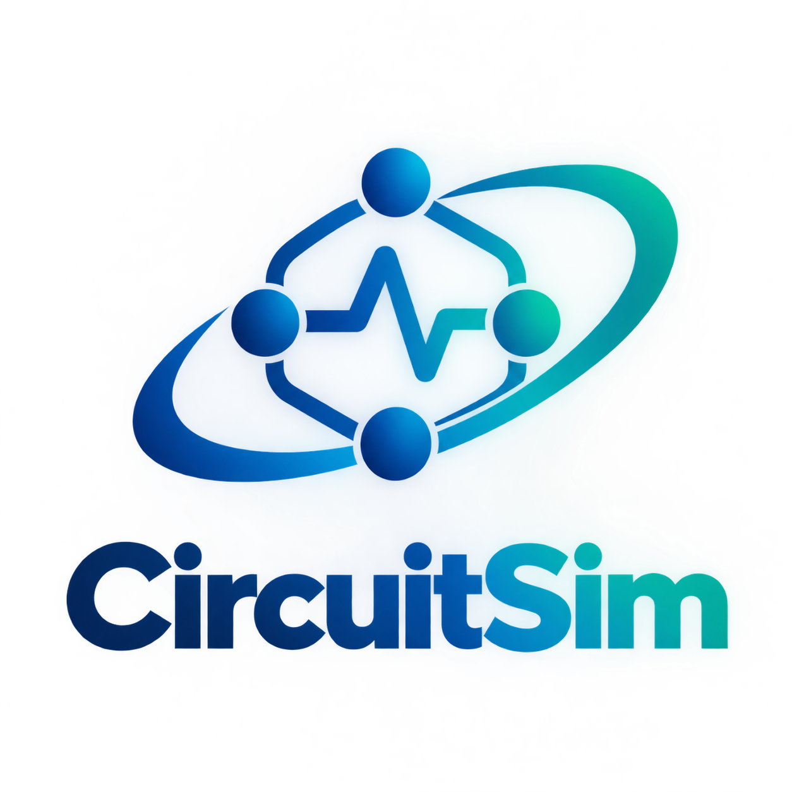
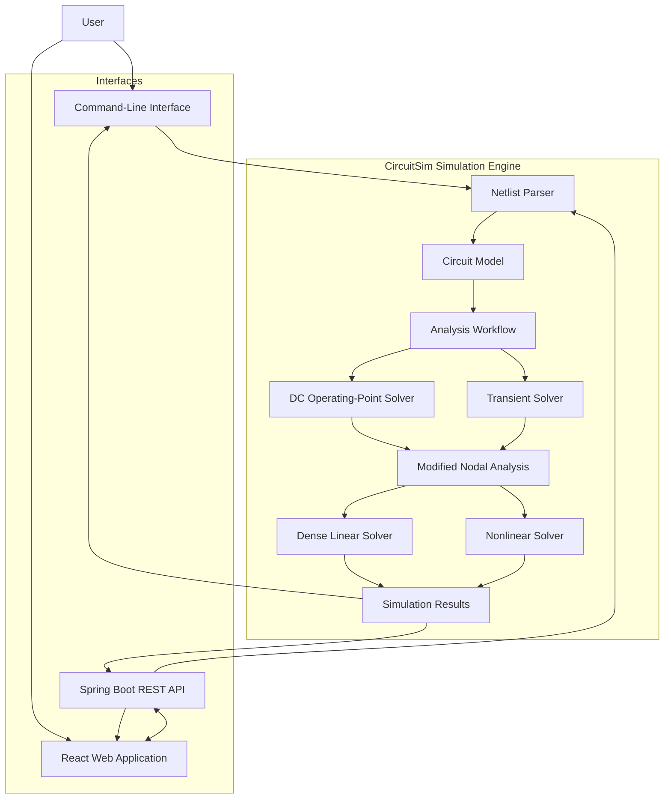

# CircuitSim

A modular, Java-based circuit simulation platform providing numerical circuit analysis through a reusable simulation engine, command-line interface, REST API, and interactive React web application.

CircuitSim separates circuit representation, netlist parsing, numerical analysis, simulation results, and user-facing interfaces behind explicit contracts. The platform provides a bounded SPICE-inspired netlist format and an understandable implementation of fundamental circuit-analysis techniques.

The emphasis is on **clear numerical methods, explicit simulation outcomes, modular design, interactive visualization, and testable behavior**, not full SPICE compatibility.

<p align="center">
  
</p>

---

## Table of Contents

- [Overview](#overview)
- [Release 1 and Release 2](#release-1-and-release-2)
- [Design Decisions and Implementation Scope](#design-decisions-and-implementation-scope)
- [Target Architecture](#target-architecture)
- [Project Structure](#project-structure)
- [Architecture and Design Principles](#architecture-and-design-principles)
- [Circuit Model and Numerical Methods](#circuit-model-and-numerical-methods)
- [Simulation Results](#simulation-results)
- [REST API](#rest-api)
- [React Web Application](#react-web-application)
- [Running the Application](#running-the-application)
- [Example Netlists](#example-netlists)
- [CLI Output Formats](#cli-output-formats)
- [Verification and Testing](#verification-and-testing)
- [Known Limitations and Future Work](#known-limitations-and-future-work)
- [Technology Stack](#technology-stack)
- [Project Status](#project-status)
- [License](#license)
- [Maintainer](#maintainer)

---

## Overview

Circuit simulation translates a circuit description into a mathematical system, solves that system, and reports results with enough information to distinguish successful analysis from numerical or input failures.

CircuitSim establishes a modular architecture for this workflow by separating the simulation engine from its user interfaces.

The platform consists of four primary components:

1. **Simulation Engine:** Circuit representation, parsing, numerical analysis, solution data, and diagnostics.
2. **Command-Line Interface:** Local circuit simulation and text/JSON result delivery.
3. **REST API:** HTTP-based access to the existing simulation engine.
4. **React Web Application:** Interactive circuit editing, simulation execution, topology visualization, and numerical waveform analysis.

The implementation provides:

- A bounded, SPICE-inspired netlist input format.
- Circuit representation and parsing.
- DC operating-point analysis.
- Fixed-step transient analysis using Backward Euler and trapezoidal integration.
- A dense linear-system solver.
- Resistor, capacitor, inductor, independent voltage/current source, and built-in Shockley-style diode models.
- Text and JSON CLI result output.
- A Spring Boot REST API with executable JAR and external Tomcat WAR deployment options.
- A React and TypeScript web application.
- Interactive transient waveform visualization using Plotly.
- Circuit netlist editing using CodeMirror.
- Circuit topology visualization.
- Automated backend and frontend testing.

The simulation engine remains independent of the CLI, HTTP infrastructure, Spring Boot, and React. The REST API and web application reuse the existing numerical implementation rather than duplicating simulation logic.

The supplied examples and verification activities demonstrate end-to-end functionality, not exhaustive numerical validation.

## Release 1 and Release 2

### Release 1 — Simulation Engine and CLI

Release 1 established the numerical foundation of CircuitSim.

Its primary capabilities include:

- Modular Java simulation engine.
- Bounded SPICE-inspired netlist parser.
- Circuit model and component representation.
- Modified nodal analysis (MNA).
- DC operating-point analysis.
- Fixed-step transient analysis.
- Backward Euler and trapezoidal integration.
- Dense linear-system solution.
- Built-in nonlinear diode model.
- CLI execution and result delivery.
- Text and JSON output.

The CLI provides a direct way to execute circuit simulations without requiring a web application or HTTP service.

### Release 2 — REST API and React Web Application

Release 2 extends CircuitSim into an interactive web-based simulation platform.

The backend adds a Spring Boot REST API that exposes the existing simulation engine through HTTP endpoints. It supports both standalone executable JAR deployment using embedded Tomcat and WAR deployment to an external Tomcat container.

The frontend adds a React and TypeScript application built with Vite. It provides an interactive simulation workbench incorporating:

- Circuit netlist editing through CodeMirror.
- Circuit example selection.
- REST API integration and simulation execution.
- DC numerical results.
- Transient waveform visualization through Plotly.
- Circuit topology visualization.
- Simulation status and diagnostics.

The frontend connects circuit input, simulation execution, topology, and numerical results into a unified engineering interface.

Release 2 does not introduce a second simulation engine. Both the CLI and REST API use the same underlying numerical engine.

---

## Design Decisions and Implementation Scope

### Architectural decisions

1. **Separate engine and interfaces.** Circuit modeling, parsing, numerical analysis, and results belong to the engine rather than the CLI, REST API, or frontend.

2. **Use a bounded netlist language.** The parser supports an explicitly limited SPICE-inspired syntax, not the complete SPICE language.

3. **Use modified nodal analysis (MNA).** Circuit equations are assembled into a system for node voltages and voltage-source branch currents.

4. **Make transient integration explicit.** Backward Euler and trapezoidal integration are the fixed-step methods.

5. **Separate linear and nonlinear analysis.** Linear equations use a dense solver; the built-in diode requires nonlinear solution.

6. **Preserve outcomes and diagnostics.** A failed analysis must not be represented as a successful result with misleading default values.

7. **Keep the numerical engine interface-independent.** CLI, REST API, and browser-based interfaces must not introduce presentation or transport dependencies into the engine.

8. **Separate transport from simulation.** HTTP request processing, JSON serialization, and deployment concerns belong to the API layer.

9. **Keep the frontend focused on scientific analysis.** The React application provides circuit editing, topology visualization, waveform analysis, and numerical result inspection without duplicating solver logic.

10. **Favor understandable, testable implementations.** CircuitSim is a bounded reference implementation, not an attempt to reproduce the complexity of a commercial SPICE simulator.

### Scope of the current implementation

The overall workflow is:

1. Read a circuit netlist.
2. Parse and validate supported syntax.
3. Construct the circuit model.
4. Assemble and solve DC operating-point equations.
5. Perform transient analysis when requested.
6. Record solution samples, status, and diagnostics.
7. Deliver results through the CLI or REST API.
8. Present results through text, JSON, or the React web application.
9. Visualize circuit topology and transient behavior in the browser.

---

## Target Architecture

CircuitSim separates the numerical engine from the CLI, REST API, and React application.



The diagram represents conceptual responsibilities and dependencies. It does not assert that every box corresponds to a separate Java class or Maven module.

### Deployment architecture

The REST API supports two deployment modes:

**Executable JAR**

The Spring Boot application runs as a standalone executable using embedded Tomcat.

**External Tomcat WAR**

The application can also be packaged as a WAR and deployed to an external Tomcat servlet container.

These deployment options allow the backend to operate independently of the React development environment and support different hosting configurations.

### Analysis-to-result flow

1. **Input:** The CLI or REST API receives a circuit description.
2. **Parsing:** The parser interprets the supported circuit-description syntax.
3. **Model construction:** Circuit elements and connections are represented in the engine.
4. **DC analysis:** The engine solves the operating point used to initialize transient analysis.
5. **Transient analysis:** The engine advances through time using the selected integration method.
6. **Numerical solution:** Linear systems are solved directly; nonlinear systems use an iterative process.
7. **Result construction:** The engine records outcome, solution data, and diagnostics.
8. **Delivery:** The CLI formats the result or the REST API serializes it for the frontend.
9. **Presentation:** The React application displays numerical results, diagnostics, topology, and waveforms.

---

## Project Structure

The project is organized as a multi-module Maven application with a separate React frontend.

```text
CircuitSim/
├── assets/logos/            # Images and logos
├── circuitsim-engine/       # Circuit model and simulation engine
├── circuitsim-cli/          # Command-line application
├── circuitsim-api/          # Spring Boot REST API
├── circuitsim-api-war/      # External Tomcat WAR deployment
├── circuitsim-web/          # React and TypeScript frontend
├── docs/                    # SDS, notes, handoffs
├── examples/                # Example circuit netlists
├── pom.xml                  # Maven parent project
└── README.md
```

### Module responsibilities

| Module               | Responsibility                                                                      |
| -------------------- | ----------------------------------------------------------------------------------- |
| `circuitsim-engine`  | Circuit representation, parsing, numerical analysis, solution data, and diagnostics |
| `circuitsim-cli`     | Command-line arguments, application execution, and result delivery                  |
| `circuitsim-api`     | Spring Boot REST API and executable JAR deployment                                  |
| `circuitsim-api-war` | WAR packaging for deployment to an external Tomcat container                        |
| `circuitsim-web`     | React application, circuit editor, topology visualization, and waveform analysis    |
| `examples`           | Example circuit netlists                                                            |
| `pom.xml`            | Maven build and dependency management                                               |

The CLI and API depend on the engine. The engine must not depend on the CLI, HTTP infrastructure, Spring Boot, or React.

The frontend communicates with the engine through the REST API rather than directly accessing Java implementation classes.

---

## Architecture and Design Principles

### 1. Circuit representation and parsing

The parser converts supported component declarations and analysis directives into the engine's circuit representation. It does not aim to accept arbitrary SPICE files.

Invalid circuit descriptions must be distinguished from numerical failures that occur after analysis begins.

### 2. Modified nodal analysis

In linear form, the modified nodal analysis system can be represented as:

```math
\begin{bmatrix}
G & B \\
B^T & 0
\end{bmatrix}
\begin{bmatrix}
v \\
i_V
\end{bmatrix}
=
\begin{bmatrix}
j \\
e
\end{bmatrix}
```

where:

- $G$ represents nodal conductance contributions.
- $B$ represents voltage-source incidence relationships.
- $v$ contains unknown node voltages.
- $i_V$ contains unknown voltage-source branch currents.
- $j$ and $e$ represent current and voltage source terms.

Capacitors and inductors introduce time-dependent relationships during transient analysis. The diode introduces nonlinear current-voltage behavior.

### 3. Linear and nonlinear solution

Linear circuit systems use a dense linear solver. The built-in diode introduces nonlinear equations requiring iterative solution.

Convergence must be assessed using actual solution behavior and appropriate checks. Completing an iteration does not, by itself, establish that the result is physically consistent.

Numerical tolerances, convergence criteria, and diagnostics require verification before broader correctness claims are made.

### 4. Separation of analysis and result delivery

The engine produces results independently of how they are displayed.

The CLI selects and formats the output representation. The REST API provides structured HTTP access to simulation requests and results. The React application presents those results interactively.

This separation allows additional interfaces to reuse the same analysis implementation without introducing presentation-specific dependencies into the engine.

### 5. Separation of backend and frontend responsibilities

The REST API is responsible for request handling, validation, invocation of the simulation engine, and result serialization.

The React application is responsible for user interaction, circuit editing, visualization, and presentation.

Numerical simulation algorithms remain in the Java engine. The frontend does not independently calculate or reconstruct circuit simulation results.

---

## Circuit Model and Numerical Methods

### DC operating-point analysis

DC operating-point analysis solves for the circuit's steady operating state under the applicable source interpretation and component equations. The resulting state initializes transient analysis.

The treatment of time-dependent sources in DC analysis follows the implementation's defined semantics and does not claim complete compatibility with every SPICE operating-point convention.

### Transient analysis

Transient analysis computes circuit behavior over a requested interval using fixed time steps.

The implementation supports:

- **Backward Euler:** A first-order implicit integration method.
- **Trapezoidal integration:** A second-order method based on averaging the derivative across a time interval.

For a capacitor, the Backward Euler discretization is:

```math
i_{C,n} = \frac{C}{h}(v_{C,n} - v_{C,n-1})
```

where $C$ is capacitance and $h$ is the time-step size.

The trapezoidal discretization is:

```math
i_{C,n} = \frac{2C}{h}(v_{C,n} - v_{C,n-1}) - i_{C,n-1}
```

The corresponding inductor equations use the inductor's current and voltage history.

The timestep is constrained by source events and the requested final simulation time. The solver uses the actual step size for each interval. Adaptive timestep control is outside the current implementation scope.

### Nonlinear diode model

CircuitSim includes a built-in Shockley-style diode model. This is a bounded model, not the full collection of semiconductor models, parameters, and numerical techniques found in production SPICE simulators.

Nonlinear convergence and current consistency remain under verification. The supplied diode example has shown a small difference between reported resistor and diode currents. This is an open numerical-consistency observation and must not be treated as resolved until the cause and any corrective action are supported by evidence.

### Numerical scope and limitations

The implementation uses a dense linear solver and fixed-step integration. It targets small educational and engineering circuits.

Important limitations include:

- No adaptive timestep control.
- No claim of full SPICE language or device-model compatibility.
- No broad semiconductor-device library such as MOSFET models.
- No claim of exhaustive numerical validation.
- Successful execution alone does not establish circuit-law consistency for every supported configuration.

---

## Simulation Results

Simulation results distinguish analysis outcome from numerical data.

The result model preserves:

- Overall analysis status.
- Available solution data, including node voltages and applicable branch currents.
- Transient samples when requested.
- Diagnostics associated with parsing, solving, convergence, or delivery.

A failed analysis must not be represented as a successful solution by silently substituting zero for unavailable values.

For transient analysis, accepted samples represent solution states that pass the applicable step-acceptance logic. A failed trial step must not be incorporated into accepted solution history.

A run can complete while further verification is still needed to establish the accuracy and consistency of its reported values.

---

## REST API

Release 2 introduces a Spring Boot REST API that exposes the existing CircuitSim simulation engine through HTTP.

The API provides a service boundary between browser-based applications and the numerical engine. It handles incoming requests, invokes the engine, and returns structured simulation results.

### API capabilities

The implemented API includes:

| Endpoint / operation | Purpose                                          |
| -------------------- | ------------------------------------------------ |
| `/api/health`        | Application health check                         |
| `/api/examples`      | Access to available example circuits             |
| DC simulation        | Submit a circuit for DC operating-point analysis |
| Transient simulation | Submit a circuit for transient analysis          |

The API provides:

- Circuit simulation requests.
- Structured JSON responses.
- Simulation status and numerical results.
- Request validation.
- Error responses for invalid and empty requests.
- Integration with the existing numerical engine.

The API does not implement a separate circuit solver.

### Deployment modes

The backend supports two deployment configurations.

**Executable JAR with embedded Tomcat**

The Spring Boot application defaults to port 8080. The port can be overridden with the `CIRCUITSIM_PORT` environment variable. During verification, the executable JAR ran with embedded Tomcat 10.1.46 on port 8081 because the external Tomcat instance was already using port 8080.

**WAR deployment to external Tomcat**

The WAR package is named `circuitsim-api.war` and can be deployed to an external Tomcat servlet container. Deployment was verified with Tomcat 11.0.27 under the `/circuitsim` application context.

External Tomcat verification applies to the tested Tomcat 11.0.27 environment only.

### API verification

Reported backend verification included:

| Test                      | Result            |
| ------------------------- | ----------------- |
| Maven `clean verify`      | Successful        |
| `/api/health`             | HTTP 200          |
| `/api/examples`           | HTTP 200          |
| DC simulation             | HTTP 200, SUCCESS |
| Transient simulation      | HTTP 200, SUCCESS |
| Invalid request           | HTTP 400          |
| Empty request             | HTTP 400          |
| External Tomcat health    | Verified          |
| External Tomcat examples  | Verified          |
| External Tomcat DC        | Verified          |
| External Tomcat transient | Verified          |

The API transient example returned 51 samples for the verified RC example.

---

## React Web Application

Release 2 introduces a React and TypeScript frontend built with Vite.

The frontend provides an interactive simulation workbench for editing circuit descriptions, executing simulations, and exploring numerical results.

The application is designed as an engineering interface rather than a generic request-and-response form.

### Simulation workbench

The workbench brings together:

- Circuit netlist editing.
- Example circuit selection.
- Simulation execution.
- Simulation status and diagnostics.
- DC numerical results.
- Transient waveform visualization.
- Circuit topology visualization.

The frontend communicates with the backend through the REST API.

### Circuit editor

The application uses CodeMirror for circuit/netlist editing.

The editor provides a working environment for entering and modifying supported circuit descriptions and loading supplied examples.

The circuit description remains the input to the existing engine; the frontend does not introduce a separate circuit-description language.

### Interactive waveform visualization

Plotly is used to visualize transient simulation results.

The waveform view allows users to explore simulation behavior graphically rather than relying exclusively on numerical output tables.

The frontend receives transient simulation results from the REST API and presents the available waveform data.

### Circuit topology visualization

The application includes a visual representation of circuit topology.

This provides a graphical view of circuit connectivity and complements the textual netlist representation and numerical results.

The topology view is a visualization of the circuit model, not a full graphical schematic editor.

### Numerical results and diagnostics

The frontend presents simulation output and status information received from the API.

This connects the circuit definition, simulation execution, and numerical results in a single browser-based workflow.

### Browser integration verification

Browser integration was verified against the running REST API.

The reported browser verification included:

- Successful frontend-to-API communication.
- Successful transient simulation request.
- Transient results received and displayed.
- Plotly transient chart visible.
- Circuit topology visualization visible.
- No reported red errors in the browser console during the verified test.

The observed browser test contained:

| Observation            | Result                 |
| ---------------------- | ---------------------- |
| Transient samples      | 54                     |
| Nodes                  | 3                      |
| Components             | 3                      |
| Waveform visualization | Visible                |
| Circuit topology       | Visible                |
| Browser console        | No reported red errors |

The 54-sample browser observation is distinct from the 51-sample API RC example verification. They are separate test observations and should not be treated as interchangeable results.

---

## Running the Application

### Prerequisites

Backend:

- Java Development Kit (the recorded verification environment used JDK 25.0.5).
- Apache Maven (the recorded verification environment used Maven 3.9.6).

The approved Java project target is **Java 25**.

Frontend:

- Node.js (the recorded verification environment used 24.11.1).
- npm (the recorded verification environment used 11.6.2).

Check the active toolchain:

```bash
java -version
mvn -version
node --version
npm --version
```

### Build and verify the backend

From the repository root:

```bash
mvn clean verify
```

The full Maven reactor completed successfully during Release 2 verification. This builds and verifies the engine, CLI, REST API, and WAR modules. The CLI is configured to produce an executable shaded JAR that includes its engine dependency. The Spring Boot API also provides executable JAR packaging.

### Run the CLI

After packaging, run the supplied examples from the repository root.

Resistor DC example:

```bat
java -jar circuitsim-cli\target\circuitsim-cli-1.0.0-SNAPSHOT.jar --format text examples\resistor.cir
```

RC transient example:

```bat
java -jar circuitsim-cli\target\circuitsim-cli-1.0.0-SNAPSHOT.jar --format text examples\rc.cir
```

Diode DC example:

```bat
java -jar circuitsim-cli\target\circuitsim-cli-1.0.0-SNAPSHOT.jar --format both examples\diode.cir
```

### Run the standalone REST API

The Spring Boot executable JAR uses embedded Tomcat. The application defaults to port 8080, as configured in `circuitsim-api\\src\\main\\resources\\application.properties`:

```properties
server.port=${CIRCUITSIM_PORT:8080}
```

To run it on port 8081 (the port used during verification while external Tomcat occupied 8080), open a CMD window at the repository root and run:

```cmd
set "CIRCUITSIM_PORT=8081"
java -jar circuitsim-api\\target\\circuitsim-api-1.0.0-SNAPSHOT-exec.jar --circuitsim.cors-origin=http://localhost:3000
```

The API is then available at `http://localhost:8081`. For example, the health endpoint is `http://localhost:8081/api/health`.

To use the default port instead, set `CIRCUITSIM_PORT=8080` or leave the variable unset, provided port 8080 is available.

### Run the external Tomcat WAR deployment

The WAR artifact is `circuitsim.war`. Deploy it to the external Tomcat instance using the deployment procedure for that Tomcat installation. The verified deployment used Tomcat 11.0.27 and the `/circuitsim` context, with the server listening on port 8080.

With that deployment, the API base URL is `http://localhost:8080/circuitsim`; for example, the health endpoint is `http://localhost:8080/circuitsim/api/health`.

### Build and test the frontend

From the repository root:

```cmd
cd circuitsim-web
npm ci
npm test
npm run build
```

The Release 2 frontend verification used Vite 6.4.5 and Vitest 3.2.7. The production build completed successfully, with a documented bundle-size warning described in [Known Limitations and Future Work](#known-limitations-and-future-work).

### Run the React development server

The frontend uses Vite. CircuitSim configures Vite to use port 3000 so the workbench is available at `http://localhost:3000`.

Start the standalone API on port 8081 in a separate CMD window first. Then, in the frontend CMD window:

```cmd
cd circuitsim-web
set "CIRCUITSIM_API_TARGET=http://localhost:8081"
npm run dev
```

For the external Tomcat WAR deployment on port 8080, use this proxy target instead:

```cmd
cd circuitsim-web
set "CIRCUITSIM_API_TARGET=http://localhost:8080/circuitsim"
npm run dev
```

The `CIRCUITSIM_API_TARGET` setting controls where Vite forwards browser requests beginning with `/api`. It is a development-server setting; it does not change the API server's listening port.

To stop either development process, press `Ctrl+C` in its CMD window.

---

## Example Netlists

The repository includes three example circuits used for initial end-to-end execution.

### Resistor — DC analysis

```text

```

The resistor example exercises a simple linear circuit and reports its DC solution.

The recorded local CLI result was:

```text
V(IN) = 5 V
I(R1) = 0.005 A
Status = SUCCESS
```

### RC circuit — transient analysis

The RC example exercises transient simulation of a resistor-capacitor circuit.

The recorded local CLI result was:

```text
Status = SUCCESS
Accepted samples = 51
V(OUT) = 4.964684796758279 V
```

The API verification also returned SUCCESS with 51 samples for its RC example.

The browser integration test separately observed 54 transient samples.

### Diode — DC analysis

The diode example exercises the nonlinear diode model and produces text and JSON output.

The recorded local CLI result was:

```text
Status = SUCCESS
V(OUT) = 0.6928897315283103 V
Iterations = 17
```

The diode example also produced a small difference between the reported resistor and diode currents. This numerical-consistency observation remains documented for further investigation.

These examples demonstrate initial end-to-end execution, not exhaustive validation.

---

## CLI Output Formats

The CLI supports the following documented `--format` choices:

- `text` — human-readable output.
- `json` — machine-readable JSON output.
- `both` — text and JSON output.

For example:

```bat
java -jar circuitsim-cli\target\circuitsim-cli-1.0.0-SNAPSHOT.jar --format json examples\resistor.cir
```

CSV output is within the intended Release 1 scope where supported by the implemented command-line options. Consult the current CLI usage output and implementation for the exact CSV invocation and available options.

---

## Verification and Testing

CircuitSim has been verified through backend, frontend, CLI, API integration, and browser execution.

### Backend verification

The reported full Maven reactor command:

```bash
mvn clean verify
```

completed successfully.

The API was verified in both executable JAR and external WAR deployment modes.

### Frontend verification

The frontend test framework was Vitest 3.2.7.

Vitest 4.1.12 had produced a reproducible test-registration/runtime issue in the project environment, so Vitest 3.2.7 was selected.

The reported frontend test command:

```bash
npm test
```

passed:

- One test file.
- Four tests.

The production build command:

```bash
npm run build
```

completed successfully using Vite 6.4.5.

### Browser integration

The browser integration test verified the frontend's communication with the API and the display of transient simulation results, a Plotly waveform, and circuit topology.

The observed browser test contained 54 transient samples, three nodes, and three components.

### Verification boundaries

Successful builds and tests do not establish exhaustive numerical correctness.

The current verification does not establish:

- Correct behavior for every possible circuit configuration.
- Compatibility with every browser.
- Compatibility with every Tomcat version.
- Performance under large simulation workloads.
- Production security readiness.
- Exhaustive numerical validation of all supported components and analyses.

---

## Known Limitations and Future Work

CircuitSim is a bounded reference implementation. Its current scope prioritizes a small, reviewable numerical implementation and a usable web-based simulation interface.

### Numerical methods and solver robustness

Potential future work includes:

- Adaptive timestep control.
- Broader convergence and numerical-consistency testing.
- Further validation of nonlinear initialization, convergence criteria, and diode voltage limiting.
- Verification of singular systems, ill-conditioned circuits, and difficult nonlinear operating points.
- Performance optimization for large circuit matrices.
- Evaluation of alternative linear-algebra implementations.

The previously observed diode current discrepancy remains an open numerical-consistency investigation.

The recorded diode example values were:

```text
I(R1) = 0.00430711026847169 A
I(D1) = 0.004307428431263649 A
```

The difference is approximately \(3.18 \times 10^{-7}\) A.

Successful solver convergence does not, by itself, establish that this discrepancy has been resolved.

### Circuit and device modeling

Potential future extensions include:

- Broader SPICE language compatibility.
- Expanded semiconductor models, including MOSFETs.
- A broader device-model and parameter ecosystem.
- More extensive source-waveform and analysis-directive support.
- Validation against a wider range of reference circuits and established simulators.

These are extensions beyond the current bounded implementation.

### Frontend architecture and integration

The current React application provides a standalone CircuitSim workbench.

Potential future work includes:

- Separating reusable CircuitSim frontend components from the standalone application shell.
- Further modularization of the visualization and simulation interface.
- Integration with a broader scientific-computing application or umbrella platform.
- Additional frontend performance optimization and code splitting.
- Expanded browser and interaction testing.

Frontend architectural refactoring and broader platform integration are separate activities from the completed Release 2 implementation.

### Deployment and operations

The executable JAR and external Tomcat WAR deployment modes have been verified.

The following activities remain outside the completed Release 2 scope:

- Public VPS deployment.
- Public DNS configuration.
- HTTPS certificate and TLS configuration.
- Production reverse proxy configuration.
- Production hosting and operational configuration.
- Authentication and user management.

These activities require separate deployment and security decisions.

### Frontend dependency and bundle-size findings

The production JavaScript bundle was approximately 5.43 MB before gzip, and Vite reported a chunk-size warning.

The reported `npm audit` identified three vulnerabilities in the frontend dependency tree:

- One moderate vulnerability.
- Two critical vulnerabilities.

The findings included dependencies associated with the Vitest 3.2.7 dependency tree, including `@vitest/mocker` and `tinypool`.

An `npm audit fix` attempt did not resolve the findings without potentially disruptive dependency changes. No `--force` remediation was applied.

These findings require dependency and security review before public production deployment.

The frontend build and test results should not be interpreted as evidence that the dependency tree is security-clean.

### Verification priorities

Future verification should include:

- Regression coverage for the diode current-consistency investigation.
- Broader numerical checks against analytical results.
- More extensive circuit benchmarks.
- Verification under the approved Java 25 toolchain.
- Additional testing of invalid input, numerical failures, and boundary conditions.
- Broader browser and deployment-environment testing.
- Frontend dependency and bundle-size review.

These are verification priorities, not claims that the implementation is incorrect in all such cases. Findings should be documented with reproducible evidence.

---

## Technology Stack

### Backend

- **Java 25** — approved language and runtime target.
- **Maven** — multi-module build and dependency management.
- **Spring Boot 3.5.6** — REST API framework.
- **Spring Web** — HTTP endpoint implementation.
- **Jackson** — JSON serialization and deserialization.
- **Tomcat 10.1.46** — embedded Tomcat version used in executable JAR verification.
- **Tomcat 11.0.27** — external Tomcat version used in WAR deployment verification.
- **JUnit 5.11.4** — automated backend testing.
- **Maven Shade Plugin 3.6.0** — executable CLI packaging.

### Frontend

- **React** — component-based user interface.
- **TypeScript** — frontend implementation and type definitions.
- **Vite 6.4.5** — frontend development and production build.
- **Vitest 3.2.7** — frontend testing.
- **Plotly** — interactive waveform visualization.
- **CodeMirror** — circuit netlist editing.
- **npm** — frontend dependency management and scripts.

### Numerical computing

- **Modified Nodal Analysis** — circuit equation formulation.
- **Dense linear solver** — initial linear-system solution.
- **Nonlinear iterative solution** — built-in diode analysis.
- **Backward Euler and trapezoidal integration** — fixed-step transient analysis.

The local development environment has also been used to build and execute the initial implementation with Java 19. The approved target remains Java 25.

---

## Project Status

CircuitSim Release 1 established the numerical simulation engine and CLI. The engine and CLI have been packaged and exercised against the supplied resistor, RC, and diode examples.

CircuitSim Release 2 has completed its implementation and reported verification activities. It adds:

- Spring Boot REST API.
- Executable JAR deployment with embedded Tomcat.
- WAR deployment to external Tomcat.
- React and TypeScript frontend.
- Vite-based frontend build.
- CodeMirror circuit editor.
- Plotly transient waveform visualization.
- Circuit topology visualization.
- Browser integration with the REST API.

The backend Maven reactor verification succeeded. Frontend tests and production build succeeded. API deployment and browser integration were also verified in the recorded environments.

The project retains documented limitations:

- The diode example's current-consistency observation remains unresolved.
- Exhaustive numerical validation has not been established.
- The frontend production build reports a chunk-size warning.
- The frontend dependency audit reported one moderate and two critical vulnerabilities.
- Public production deployment and security readiness have not been established.

The Release 1 and Release 2 implementation baseline is therefore established, with the limitations above retained as explicit follow-up items.

Future work may extend numerical robustness, circuit modeling, frontend modularity, deployment, and integration. Such work should preserve the separation between the numerical engine and its user interfaces.

The authoritative project-control workstream determines workstream status, formal closure, and subsequent implementation authorization.

---

## License

A license has not yet been specified. Until a license is added to the repository, no open-source license should be inferred.

---

## Maintainer

CircuitSim is developed and maintained by Chris Romero.
