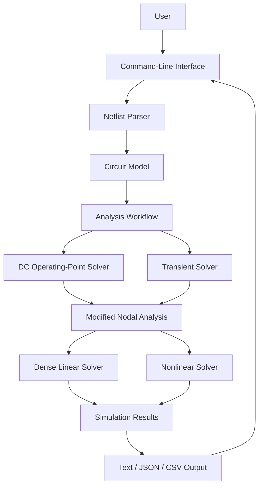

# CircuitSim

A modular, Java-based reference implementation for circuit analysis and
transient simulation, built with **Java, Maven, and a command-line
interface**.

CircuitSim separates circuit representation, netlist parsing, numerical
analysis, simulation results, and user-facing output behind explicit
contracts. Release 1 focuses on a bounded SPICE-inspired netlist format
and an understandable implementation of fundamental circuit-analysis
techniques.

The emphasis is on **clear numerical methods, explicit simulation
outcomes, modular design, and testable behavior**, not full SPICE
compatibility.

<!-- Replace the path below with the repository's actual logo path. -->
<p align="center">
  
</p>

------------------------------------------------------------------------

## Table of Contents

-   [Overview](#overview)
-   [Design Decisions and Implementation
    Scope](#design-decisions-and-implementation-scope)
-   [Target Architecture](#target-architecture)
-   [Project Structure](#project-structure)
-   [Architecture and Design
    Principles](#architecture-and-design-principles)
-   [Circuit Model and Numerical
    Methods](#circuit-model-and-numerical-methods)
-   [Simulation Results](#simulation-results)
-   [Running the Application](#running-the-application)
-   [Example Netlists](#example-netlists)
-   [CLI Output Formats](#cli-output-formats)
-   [Intentionally Deferred Work](#intentionally-deferred-work)
-   [Technology Stack](#technology-stack)
-   [Project Status](#project-status)
-   [License](#license)
-   [Maintainer](#maintainer)

------------------------------------------------------------------------

## Overview

Circuit simulation translates a circuit description into a mathematical
system, solves that system, and reports results with enough information
to distinguish successful analysis from numerical or input failures.

CircuitSim establishes a modular architecture for this workflow by
separating the simulation engine from the command-line interface.

The initial Release 1 implementation provides:

-   A bounded, SPICE-inspired netlist input format.
-   Circuit representation and parsing.
-   DC operating-point analysis.
-   Fixed-step transient analysis using Backward Euler and trapezoidal
    integration.
-   A dense linear-system solver.
-   Resistor, capacitor, inductor, independent voltage/current source,
    and built-in Shockley-style diode models.
-   Text and JSON result output, with CSV subject to the implemented CLI
    options.
-   Separate Maven modules for the simulation engine and command-line
    application.
-   Example circuits for initial end-to-end execution.

The engine is intended to remain independent of its user interface so
that a planned REST API and React frontend can reuse the same analysis
implementation in Release 2.

The supplied examples demonstrate initial end-to-end functionality, not
exhaustive numerical validation.

## Design Decisions and Implementation Scope

### Architectural decisions

1.  **Separate engine and interface.** Circuit modeling, parsing,
    numerical analysis, and results belong to the engine rather than the
    CLI.
2.  **Use a bounded netlist language.** The parser supports an
    explicitly limited SPICE-inspired syntax, not the complete SPICE
    language.
3.  **Use modified nodal analysis (MNA).** Circuit equations are
    assembled into a system for node voltages and voltage-source branch
    currents.
4.  **Make transient integration explicit.** Backward Euler and
    trapezoidal integration are the fixed-step methods for the initial
    release.
5.  **Separate linear and nonlinear analysis.** Linear equations use a
    dense solver; the built-in diode requires nonlinear solution.
6.  **Preserve outcomes and diagnostics.** A failed analysis must not be
    represented as a successful result with misleading default values.
7.  **Keep the implementation bounded.** The initial release favors
    understandable, testable methods over production-simulator
    complexity.
8.  **Defer interface expansion.** REST and React belong to Release 2
    and should reuse the engine.

### Scope of the current implementation

The workflow is:

1.  Read a circuit netlist.
2.  Parse and validate supported syntax.
3.  Construct the circuit model.
4.  Assemble and solve DC operating-point equations.
5.  Perform transient analysis when requested.
6.  Record solution samples, status, and diagnostics.
7.  Format and deliver results through the CLI.

The supplied resistor, RC, and diode examples have executed successfully
in the local development environment. Broader validation of numerical
correctness, convergence, and edge cases remains in progress.

## Target Architecture

The architecture separates the command-line boundary from the
circuit-analysis engine.



This diagram shows conceptual responsibilities; it does not assert that
each box corresponds to a separate Java class or module.

### Analysis-to-result flow

1.  **Input:** The CLI receives a netlist path and output options.
2.  **Parsing:** The parser interprets the supported circuit-description
    syntax.
3.  **Model construction:** Circuit elements and connections are
    represented in the engine.
4.  **DC analysis:** The engine solves the operating point used to
    initialize transient analysis.
5.  **Transient analysis:** The engine advances through time using the
    selected integration method.
6.  **Numerical solution:** Linear systems are solved directly;
    nonlinear systems use an iterative process.
7.  **Result construction:** The engine records outcome, solution data,
    and diagnostics.
8.  **Output:** The CLI formats the result.

## Project Structure

``` text
CircuitSim/
├── circuitsim-engine/   # Circuit model and simulation engine
├── circuitsim-cli/      # Command-line application
├── examples/            # Example circuit netlists
├── pom.xml              # Maven parent project
└── README.md
```

  -----------------------------------------------------------------------
  Module                              Responsibility
  ----------------------------------- -----------------------------------
  `circuitsim-engine`                 Circuit representation, analysis,
                                      numerical solution, and results

  `circuitsim-cli`                    Command-line arguments, application
                                      execution, and result delivery

  `examples`                          Example netlists

  `pom.xml`                           Maven build and dependency
                                      management
  -----------------------------------------------------------------------

The CLI depends on the engine. The engine must not depend on the CLI,
HTTP infrastructure, Spring Boot, or React. This separation allows
additional interfaces to reuse the same analysis implementation.

## Architecture and Design Principles

### 1. Circuit representation and parsing

The parser converts supported component declarations and analysis
directives into the engine's circuit representation. It does not aim to
accept arbitrary SPICE files.

Invalid circuit descriptions must be distinguished from numerical
failures that occur after analysis begins.

### 2. Modified nodal analysis

In linear form, the modified nodal analysis system can be represented
as:

```math
\begin{bmatrix}
G & B \\
B^T & 0
\end{bmatrix}
\begin{bmatrix}
v \\
i_V
\end{bmatrix}
=
\begin{bmatrix}
j \\
e
\end{bmatrix}
```
where:

-   $G$ represents nodal conductance contributions.
-   $B$ represents voltage-source incidence relationships.
-   $v$ contains unknown node voltages.
-   $i_V$ contains unknown voltage-source branch currents.
-   $j$ and $e$ represent current and voltage source terms.

Capacitors and inductors introduce time-dependent relationships during
transient analysis. The diode introduces nonlinear current-voltage
behavior.

### 3. Linear and nonlinear solution

Linear circuit systems use a dense linear solver. The built-in diode
introduces nonlinear equations requiring iterative solution.

Convergence must be assessed using actual solution behavior and
appropriate checks. Completing an iteration does not, by itself,
establish that the result is physically consistent. Numerical
tolerances, convergence criteria, and diagnostics require verification
before broader correctness claims are made.

### 4. Separation of analysis and result delivery

The engine produces results independently of how they are displayed. The
CLI selects and formats the output representation. A future HTTP API
should reuse the engine without introducing web-specific dependencies
into it.

## Circuit Model and Numerical Methods

### DC operating-point analysis

DC operating-point analysis solves for the circuit's steady operating
state under the applicable source interpretation and component
equations. The resulting state initializes transient analysis.

The treatment of time-dependent sources in DC analysis follows the
implementation's defined semantics and does not claim complete
compatibility with every SPICE operating-point convention.

### Transient analysis

Transient analysis computes circuit behavior over a requested interval
using fixed time steps. The initial release supports:

-   **Backward Euler:** A first-order implicit integration method.
-   **Trapezoidal integration:** A second-order method based on
    averaging the derivative across a time interval.

For a capacitor, the Backward Euler discretization is:

```math
i_{C,n} = \frac{C}{h}(v_{C,n} - v_{C,n-1})
```
where $C$ is capacitance and $h$ is the time-step size.

The trapezoidal discretization is:

```math
i_{C,n} = \frac{2C}{h}(v_{C,n} - v_{C,n-1}) - i_{C,n-1}
```
The corresponding inductor equations use the inductor's current and
voltage history.

The timestep is constrained by source events and the requested final
simulation time. The solver uses the actual step size for each interval.
Adaptive timestep control is outside the initial release scope.

### Nonlinear diode model

CircuitSim includes a built-in Shockley-style diode model. This is a
bounded model, not the full collection of semiconductor models,
parameters, and numerical techniques found in production SPICE
simulators.

Nonlinear convergence and current consistency remain under verification.
The supplied diode example has shown a small difference between reported
resistor and diode currents. This is an open numerical-consistency
investigation; it must not be treated as resolved until the cause and
any corrective action are supported by evidence.

### Numerical scope and limitations

The initial implementation uses a dense linear solver and fixed-step
integration. It targets small educational and engineering circuits.

Important limitations include:

-   No adaptive timestep control.
-   No claim of full SPICE language or device-model compatibility.
-   No broad semiconductor-device library such as MOSFET models.
-   No claim of exhaustive numerical validation.
-   Successful execution alone does not establish circuit-law
    consistency for every supported configuration.

## Simulation Results

Simulation results must distinguish analysis outcome from numerical
data. The result model is intended to preserve:

-   Overall analysis status.
-   Available solution data, including node voltages and applicable
    branch currents.
-   Transient samples when requested.
-   Diagnostics associated with parsing, solving, convergence, or
    delivery.

A failed analysis must not be represented as a successful solution by
silently substituting zero for unavailable values.

For transient analysis, accepted samples represent solution states that
pass the applicable step-acceptance logic. A failed trial step must not
be incorporated into accepted solution history.

A run can complete while further verification is still needed to
establish the accuracy and consistency of its reported values.

## Running the Application

### Prerequisites

-   A Java Development Kit (JDK).
-   Apache Maven.

The approved project target is **Java 25**. The implementation has also
been built and exercised locally with Java 19 using a temporary Maven
compiler-target adjustment. Java 19 does not replace the approved Java
25 target; compatibility should be rechecked under the target
configuration when that toolchain is available.

Check the active toolchain:

``` bash
java -version
mvn -version
```

### Build and test

From the repository root:

``` bash
mvn clean test
```

Package the modules:

``` bash
mvn package
```

The CLI is configured to produce an executable shaded JAR that includes
its engine dependency. Passing tests and successful packaging should be
reported alongside the environment and verification evidence; neither
proves exhaustive correctness.

## Example Netlists

The repository includes three example circuits used for initial
end-to-end execution. Run these commands from the repository root in
Windows Command Prompt after packaging.

### Resistor --- DC analysis

``` bat
java -jar circuitsim-cli\target\circuitsim-cli-1.0.0-SNAPSHOT.jar --format text examples\resistor.cir
```

This exercises a simple linear circuit and reports its DC solution.

### RC circuit --- transient analysis

``` bat
java -jar circuitsim-cli\target\circuitsim-cli-1.0.0-SNAPSHOT.jar --format text examples\rc.cir
```

This exercises transient simulation of a resistor-capacitor circuit. The
supplied example has produced 51 accepted samples in the local
development environment.

### Diode --- DC analysis

``` bat
java -jar circuitsim-cli\target\circuitsim-cli-1.0.0-SNAPSHOT.jar --format both examples\diode.cir
```

This exercises the nonlinear diode model and produces text and JSON
output. The current-consistency observation remains open for
investigation.

These examples demonstrate initial end-to-end execution, not exhaustive
validation.

## CLI Output Formats

The CLI supports the following documented `--format` choices:

-   `text` --- human-readable output.
-   `json` --- machine-readable JSON output.
-   `both` --- text and JSON output.

For example:

``` bat
java -jar circuitsim-cli\target\circuitsim-cli-1.0.0-SNAPSHOT.jar --format json examples\resistor.cir
```

CSV output is within the intended Release 1 scope where supported by the
implemented command-line options. Consult the current CLI usage output
and implementation for the exact CSV invocation and available options.

## Intentionally Deferred Work

The initial release prioritizes a small, reviewable numerical
implementation. The following areas are outside the current scope or
require further verification.

### Numerical methods and solver robustness

-   Adaptive timestep control.
-   Broader convergence and numerical-consistency testing.
-   Further validation of nonlinear initialization, convergence
    criteria, and diode voltage limiting.
-   Verification of singular systems, ill-conditioned circuits, and
    difficult nonlinear operating points.
-   Performance optimization for large circuit matrices.
-   Evaluation of alternative linear-algebra implementations.

### Circuit and device modeling

-   Full SPICE language compatibility.
-   Expanded semiconductor models, including MOSFETs.
-   A broad device-model and parameter ecosystem.
-   More extensive source-waveform and analysis-directive support.
-   Validation against a wider range of reference circuits and
    established simulators.

### User interfaces and integration

-   REST API.
-   React frontend.
-   Web-oriented request validation and error reporting.
-   Additional interfaces built on the same engine contracts.

These capabilities belong to future development rather than the current
Release 1 CLI.

### Verification

-   Regression coverage for the diode current-consistency investigation.
-   Broader numerical checks against expected analytical results.
-   More extensive circuit benchmarks.
-   Verification under the approved Java 25 toolchain.
-   Additional testing of invalid input, numerical failures, and
    boundary conditions.

These are verification priorities, not claims that the implementation is
incorrect in all such cases. Findings should be documented with
reproducible evidence.

## Technology Stack

-   **Java 25** --- approved language and runtime target.
-   **Maven** --- multi-module build and dependency management.
-   **JUnit** --- automated testing.
-   **Dense linear algebra** --- solution of the initial small circuit
    systems.
-   **Java CLI** --- initial user interface.
-   **JSON and text output** --- supported result representations, with
    CSV subject to implemented CLI options.

The local development environment has also been used to build and
execute the initial implementation with Java 19. Target-toolchain
verification remains outstanding.

## Project Status

CircuitSim Release 1 has reached an initial local implementation
milestone. The engine and CLI have been packaged and exercised against
the supplied resistor, RC, and diode examples.

The project remains under numerical verification. The diode example's
reported current discrepancy requires investigation, and successful
example execution does not establish exhaustive correctness across all
supported circuits.

The next priority is to investigate the discrepancy, establish its cause
where possible, add regression evidence for any demonstrated defect, and
document remaining verification limitations. Release 2 should build on
the resulting engine behavior rather than duplicate or bypass the
numerical implementation.

The authoritative project-control workstream determines workstream
status, closure, and subsequent implementation authorization.

## License

A license has not yet been specified. Until a license is added to the
repository, no open-source license should be inferred.

## Maintainer

CircuitSim is developed and maintained by Chris Romero.
