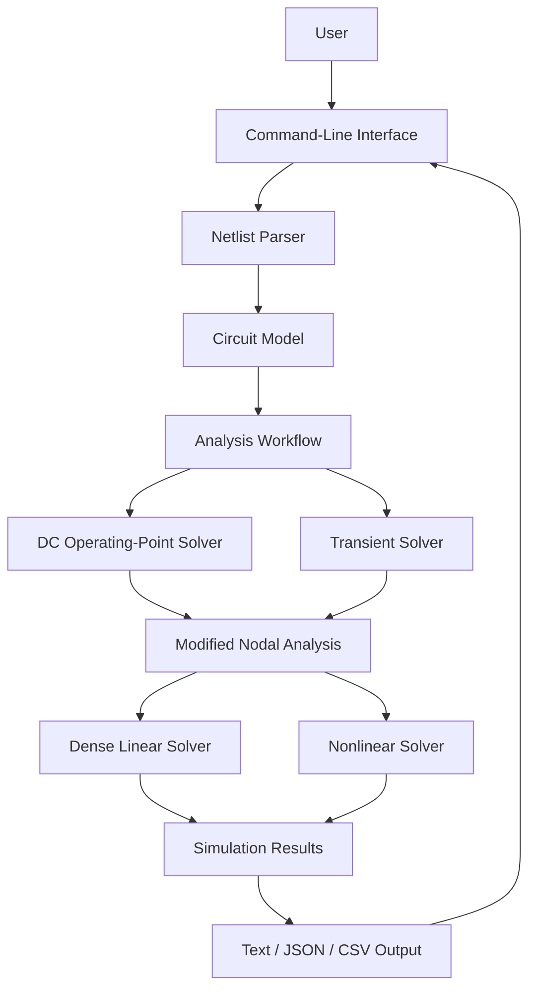

# CircuitSim

A modular, Java-based reference implementation for circuit analysis and transient simulation, built with **Java, Maven, and a command-line interface**.

CircuitSim demonstrates how to separate circuit representation, netlist parsing, numerical analysis, simulation results, and user-facing output behind explicit contracts. The initial release focuses on a bounded SPICE-inspired netlist format and a small, understandable implementation of fundamental circuit-analysis techniques.

The emphasis is on **clear numerical methods, explicit simulation outcomes, modular design, and testable behavior** rather than full SPICE compatibility.

<!--
Logo
Proposed location:
assets/logos/circuitsim-logo.png

When the logo asset is available, use:


-->
---

## Table of Contents

- [Overview](#overview)
- [Design Decisions and Implementation Scope](#design-decisions-and-implementation-scope)
- [Target Architecture](#target-architecture)
- [Project Structure](#project-structure)
- [Architecture and Design Principles](#architecture-and-design-principles)
- [Circuit Model and Numerical Methods](#circuit-model-and-numerical-methods)
- [Simulation Results](#simulation-results)
- [Running the Application](#running-the-application)
- [Example Netlists](#example-netlists)
- [CLI Output Formats](#cli-output-formats)
- [Intentionally Deferred Work](#intentionally-deferred-work)
- [Technology Stack](#technology-stack)
- [Project Status](#project-status)
- [License](#license)
- [Maintainer](#maintainer)

---

## Overview

Circuit simulation requires translating a circuit description into a mathematical system, solving that system, and reporting results with enough information to distinguish successful analysis from numerical or input failures.

CircuitSim establishes a modular architecture for this workflow by separating the simulation engine from the command-line interface.

The initial Release 1 implementation provides:

- A bounded, SPICE-inspired netlist input format.
- Circuit representation and parsing.
- DC operating-point analysis.
- Fixed-step transient analysis.
- Backward Euler and trapezoidal integration methods.
- A dense linear-system solver.
- Resistor, capacitor, inductor, independent voltage/current source, and built-in Shockley-style diode models.
- Text and JSON result output, with CSV output where supported by the implemented CLI options.
- Separate Maven modules for the simulation engine and command-line application.
- Example circuits for initial end-to-end execution.

The engine is intended to remain independent of its user interface. This allows the same simulation capabilities to support the command-line application in Release 1 and a planned REST API and React frontend in Release 2.

The current implementation targets small educational and engineering circuits. Its successful execution of the supplied examples demonstrates initial end-to-end functionality, not exhaustive numerical validation.

## Design Decisions and Implementation Scope

### Architectural decisions

1. **Separate the engine from the interface.** Circuit modeling, parsing, numerical analysis, and simulation results belong to the engine rather than the CLI.
2. **Use a bounded netlist language.** The parser supports an explicitly limited SPICE-inspired syntax instead of attempting to reproduce the complete SPICE language.
3. **Use modified nodal analysis (MNA).** Circuit equations are assembled into a mathematical system suitable for solving node voltages and voltage-source branch currents.
4. **Make transient integration explicit.** Backward Euler and trapezoidal integration are the supported fixed-step methods for the initial release.
5. **Separate linear and nonlinear analysis.** Linear circuit equations use a dense solver, while the built-in diode model requires nonlinear solution.
6. **Preserve simulation outcomes and diagnostics.** A failed analysis must not be represented as a successful result with misleading default values.
7. **Keep the numerical implementation bounded.** The initial release favors understandable methods and testable behavior over the complexity of a production circuit simulator.
8. **Defer the user-interface expansion.** REST and React functionality belong to Release 2 and should reuse the existing engine rather than duplicate its analysis logic.

### Scope of the current implementation

The initial workflow is:

1. Read a circuit netlist.
2. Parse the supported syntax and validate the circuit description.
3. Construct the circuit model.
4. Assemble and solve the DC operating-point equations.
5. Perform transient analysis when requested.
6. Record solution samples, status, and diagnostic information.
7. Format and deliver results through the CLI.

The supplied resistor, RC, and diode examples have executed successfully in the local development environment. Broader validation of numerical correctness, convergence behavior, and edge cases remains in progress.

## Target Architecture

The architecture separates the command-line boundary from the circuit-analysis engine.



The diagram represents the conceptual responsibilities of the application, not a claim that every box corresponds to a separate Java class or module.

### Analysis-to-result flow

1. **Input:** The CLI receives a netlist path and requested output options.
2. **Parsing:** The parser interprets the supported circuit-description syntax.
3. **Model construction:** Circuit elements and their connections are represented in the engine.
4. **DC analysis:** The engine solves the operating-point equations used to initialize transient analysis.
5. **Transient analysis:** When requested, the engine advances through simulation time using the selected integration method.
6. **Numerical solution:** Linear systems are solved directly; nonlinear systems require an iterative solution process.
7. **Result construction:** The engine records the analysis outcome, solution data, and diagnostics.
8. **Output:** The CLI formats the result for the requested output mode.

The CLI is a delivery layer. Numerical behavior and circuit-analysis semantics belong to the engine.

## Project Structure

The Release 1 Maven project is organized into separate engine and CLI modules.

```text
CircuitSim/
├── circuitsim-engine/   # Circuit model and simulation engine
├── circuitsim-cli/      # Command-line application
├── examples/            # Example circuit netlists
├── pom.xml              # Maven parent project
└── README.md
```

### Module responsibilities

| Module | Responsibility |
|---|---|
| `circuitsim-engine` | Circuit representation, analysis, numerical solution, and simulation results |
| `circuitsim-cli` | Command-line arguments, application execution, and result delivery |
| `examples` | Example netlists for exercising supported circuit types |
| `pom.xml` | Maven project configuration and dependency management |

The CLI depends on the engine. The engine must not depend on the CLI, HTTP infrastructure, Spring Boot, or React.

This separation is intended to allow additional interfaces to reuse the same circuit-analysis implementation.

## Architecture and Design Principles

### 1. Circuit representation and parsing

The netlist parser accepts a bounded subset of SPICE-inspired syntax. It converts textual component definitions and analysis directives into the engine's circuit representation.

The initial grammar includes supported component declarations and transient-analysis directives. It is not intended to accept arbitrary SPICE files.

The parser and model must distinguish invalid circuit descriptions from numerical failures that occur after analysis begins.

### 2. Modified nodal analysis

Modified nodal analysis provides a systematic way to formulate circuit equations. In its linear form, the assembled system can be represented as

\[
\begin{bmatrix}
G & B\\
B^T & 0
\end{bmatrix}
\begin{bmatrix}
v\\
i_V
\end{bmatrix}
=
\begin{bmatrix}
j\\
e
\end{bmatrix}
\]

where:

- \(G\) represents the nodal conductance contributions.
- \(B\) represents the voltage-source incidence relationships.
- \(v\) contains unknown node voltages.
- \(i_V\) contains unknown voltage-source branch currents.
- \(j\) and \(e\) represent the corresponding current and voltage source terms.

Capacitors and inductors introduce additional time-dependent relationships during transient analysis. The diode introduces nonlinear current-voltage behavior.

This formulation provides a common mathematical foundation for the supported circuit elements.

### 3. Linear and nonlinear solution

Linear circuit systems are handled using a dense linear solver.

The built-in diode model introduces nonlinear equations that require an iterative method. Nonlinear convergence must be evaluated using the actual solution behavior and appropriate convergence checks, rather than assuming that every completed iteration establishes a physically consistent result.

Numerical tolerances, convergence criteria, and diagnostic reporting are important parts of the solver contract. They must be validated before broader correctness claims are made.

### 4. Separation of analysis and result delivery

The engine produces simulation results independently of how those results are displayed.

The CLI is responsible for selecting and formatting the output representation. This avoids coupling the numerical implementation to terminal output or a particular serialization format.

The same separation is intended to support a future HTTP API without introducing web-specific dependencies into the engine.

## Circuit Model and Numerical Methods

### DC operating-point analysis

DC operating-point analysis solves for the circuit's steady operating state under the applicable DC source interpretation and component equations.

The resulting state is used to initialize transient analysis. This provides a consistent starting point for the supported transient workflow.

The treatment of time-dependent sources in DC analysis is limited by the implementation's defined semantics; this initial release does not claim complete compatibility with every SPICE operating-point convention.

### Transient analysis

Transient analysis computes circuit behavior over a requested simulation interval using fixed time steps.

The initial release supports:

- **Backward Euler:** A first-order implicit integration method.
- **Trapezoidal integration:** A second-order integration method based on averaging the derivative across a time interval.

For a capacitor, the backward Euler discretization is

\[
i_{C,n}=\frac{C}{h}(v_{C,n}-v_{C,n-1})
\]

where \(C\) is capacitance and \(h\) is the time-step size.

The trapezoidal discretization is

\[
i_{C,n}=\frac{2C}{h}(v_{C,n}-v_{C,n-1})-i_{C,n-1}
\]

The corresponding inductor equations are formulated using the inductor's current and voltage history.

The timestep is constrained by source events and the requested final simulation time. The solver uses the actual step size for each interval rather than assuming that all intervals are identical.

Adaptive timestep control is outside the initial release scope.

### Nonlinear diode model

CircuitSim includes a built-in Shockley-style diode model. This introduces nonlinear behavior into the circuit equations and requires iterative solution.

The model is deliberately bounded. It does not provide the full collection of semiconductor device models, parameters, and numerical techniques found in production SPICE simulators.

Nonlinear convergence and current consistency remain subjects of verification. In particular, the supplied diode example has exhibited a small difference between the reported resistor and diode currents. This is an open numerical-consistency investigation; the discrepancy should not be interpreted as resolved until its cause and any necessary corrective action are supported by evidence.

### Numerical scope and limitations

The initial implementation uses a dense linear solver and fixed-step integration. It targets small educational and engineering circuits rather than large production-scale circuit models.

Important limitations include:

- No adaptive timestep control.
- No claim of full SPICE language or device-model compatibility.
- No broad semiconductor-device library such as MOSFET models.
- No claim of exhaustive numerical validation.
- No claim that successful execution alone establishes circuit-law consistency for every supported configuration.

## Simulation Results

Simulation results must distinguish the outcome of an analysis from the numerical data it produces.

The result model is intended to preserve:

- The overall analysis status.
- Available solution data, including node voltages and applicable branch currents.
- Transient samples when transient analysis is requested.
- Diagnostics associated with parsing, solving, convergence, or delivery.

A failed analysis must not be represented as a successful solution by silently substituting zero for unavailable values.

For transient analysis, accepted samples represent solution states that have passed the applicable step-acceptance logic. A failed trial step must not be incorporated into the accepted solution history.

The distinction between successful execution and numerical correctness is important. A run can complete while further verification is still needed to establish the accuracy and consistency of its reported values.

## Running the Application

### Prerequisites

- A Java Development Kit (JDK).
- Apache Maven.

The approved project target is **Java 25**. The implementation has also been built and exercised locally with Java 19 using a temporary Maven compiler-target adjustment. Java 19 does not replace the approved Java 25 target; compatibility should be rechecked under the target configuration when that toolchain is available.

Check the active toolchain:

```bash
java -version
mvn -version
```

### Build and test

From the repository root:

```bash
mvn clean test
```

Package the modules:

```bash
mvn package
```

The CLI is configured to produce an executable shaded JAR that includes its engine dependency.

The commands above describe the build workflow. Passing tests and successful packaging should be reported alongside the actual environment and verification evidence rather than treated as proof of exhaustive correctness.

## Example Netlists

The repository includes three example circuits used for initial end-to-end execution.

Run these commands from the repository root in Windows Command Prompt after packaging.

### Resistor — DC analysis

```bat
java -jar circuitsim-cli\target\circuitsim-cli-1.0.0-SNAPSHOT.jar --format text examples\resistor.cir
```

This example exercises a simple linear circuit and reports its DC solution.

### RC circuit — transient analysis

```bat
java -jar circuitsim-cli\target\circuitsim-cli-1.0.0-SNAPSHOT.jar --format text examples\rc.cir
```

This example exercises transient simulation of a resistor-capacitor circuit. The supplied example has produced 51 accepted samples in the local development environment.

### Diode — DC analysis

```bat
java -jar circuitsim-cli\target\circuitsim-cli-1.0.0-SNAPSHOT.jar --format both examples\diode.cir
```

This example exercises the nonlinear diode model and produces text and JSON output. The current-consistency observation described above remains open for investigation.

These examples demonstrate initial end-to-end execution of the supported workflows. They are not a substitute for broader unit, regression, numerical-consistency, and benchmark testing.

## CLI Output Formats

The CLI supports the following documented `--format` choices:

- `text` — human-readable output.
- `json` — machine-readable JSON output.
- `both` — text and JSON output.

For example:

```bat
java -jar circuitsim-cli\target\circuitsim-cli-1.0.0-SNAPSHOT.jar --format json examples\resistor.cir
```

CSV output is within the intended Release 1 scope where supported by the implemented command-line options. Consult the current CLI usage output and implementation for the exact CSV invocation and options available in the build.

## Intentionally Deferred Work

The initial release prioritizes a small, reviewable numerical implementation. The following areas are outside its current scope or require further verification.

### Numerical methods and solver robustness

- Adaptive timestep control.
- Broader convergence and numerical-consistency testing.
- Further validation of nonlinear initialization, convergence criteria, and diode voltage limiting.
- Broader verification of singular systems, ill-conditioned circuits, and difficult nonlinear operating points.
- Performance optimization for large circuit matrices.
- Evaluation of alternative linear-algebra implementations.

### Circuit and device modeling

- Full SPICE language compatibility.
- Expanded semiconductor models, including MOSFETs.
- A broad device-model and parameter ecosystem.
- More extensive source-waveform and analysis-directive support.
- Validation against a wider range of reference circuits and established simulators.

### User interfaces and integration

- REST API.
- React frontend.
- Web-oriented request validation and error reporting.
- Additional interfaces built on the same engine contracts.

These capabilities belong to future development rather than the current Release 1 CLI.

### Verification

- Regression coverage for the diode current-consistency investigation.
- Broader numerical checks against expected analytical results.
- More extensive circuit benchmarks.
- Verification under the approved Java 25 toolchain.
- Additional testing of invalid input, numerical failures, and boundary conditions.

These are verification priorities, not claims that the implementation is already incorrect in all such cases. Findings should be documented with reproducible evidence and addressed at the appropriate scope.

## Technology Stack

- **Java 25** — approved language and runtime target.
- **Maven** — multi-module build and dependency management.
- **JUnit** — automated testing.
- **Dense linear algebra** — solution of the initial small circuit systems.
- **Java CLI** — initial user interface.
- **JSON and text output** — supported result representations, with CSV subject to the implemented CLI options.

The local development environment has also been used to build and execute the initial implementation with Java 19. The target-toolchain verification remains outstanding.

## Project Status

CircuitSim Release 1 has reached an initial local implementation milestone. The engine and CLI have been packaged and exercised against the supplied resistor, RC, and diode examples.

The project remains under numerical verification. In particular, the diode example's reported current discrepancy requires investigation, and successful example execution does not establish exhaustive correctness across all supported circuits.

The next priority is to investigate that discrepancy, establish its cause where possible, add regression evidence for any demonstrated defect, and document the remaining verification limitations. Release 2 should build on the resulting engine behavior rather than duplicate or bypass the numerical implementation.

The authoritative project-control workstream determines workstream status, closure, and subsequent implementation authorization.

## License

A license has not yet been specified. Until a license is added to the repository, no open-source license should be inferred.

## Maintainer

CircuitSim is developed and maintained by Chris Romero.
